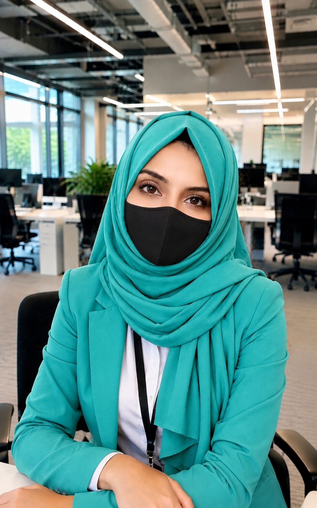

<div align="center">



# Faiza Faisal

### AI Engineering · Automation · Full-Stack Development

**Practical AI. Useful automation. Better digital experiences.**

[](https://react.dev/)
[](https://vite.dev/)
[](https://developer.mozilla.org/en-US/docs/Web/JavaScript)
[](#highlights)

[Explore the projects](#selected-projects) · [Run locally](#run-locally) · [Get in touch](#contact)

</div>

---

## Overview

A polished, responsive portfolio for **Faiza Faisal**, an AI Engineer and Full-Stack Developer based in Karachi, Pakistan. It presents practical AI and web services, selected project work, a clear delivery process, and direct contact options.

The site includes a lightweight **portfolio assistant** that answers common questions using the information published here. It needs no API key or backend, and does not send or store chat messages.

## Highlights

- **Professional portfolio** with services, projects, work process, about, and contact sections.
- **Responsive layout** with a dedicated portrait treatment for desktop and mobile screens.
- **Portfolio Q&A assistant** with suggested questions, project links, contact links, and a clear fallback for questions outside its scope.
- **Project transparency** with notes on demo availability and features that still need verification.
- **Privacy-conscious interactions**: the assistant stays in the browser; the contact form prepares an email in the visitor's email app.
- **Vercel-ready** static production build.

## Selected projects

| Project | What it explores | Repository | Demo |
| --- | --- | --- | --- |
| **Khidmat AI Assistant** | Multi-agent home-service discovery concept | [Ai-seekho](https://github.com/faizafaisal786/Ai-seekho) | [Open demo](https://ai-seekho-nu.vercel.app/) |
| **Physical AI Textbook RAG Chatbot** | Textbook-focused assistant for Physical AI and robotics learning | [GitHub](https://github.com/faizafaisal786/-Physical-AI-and-Humanoid-Robotics-Textbook-) | [Open site](https://ragchatbot-ruby.vercel.app/) |
| **AwaamFlow** | Service orchestration focused on regional language and low-connectivity access | [GitHub](https://github.com/faizafaisal786/awaamflow) | [Open demo](https://awaamflow-izje.vercel.app/) |
| **Velora Mall** | E-commerce browsing experience | [GitHub](https://github.com/faizafaisal786/velora-mall) | A public demo is not currently available. |
| **AI Company** | AI company website and multi-agent startup-builder concept | [GitHub](https://github.com/faizafaisal786/AI-Company) | [Open demo](https://ai-company-eosin.vercel.app/) |

Demo pages and application features can change. The portfolio's project cards include verification notes; review the current implementation before relying on a demo or describing a feature as production-ready.

## Services

- **AI workflow automation** — workflow mapping, integrations, notifications, testing, and handover.
- **AI assistants and RAG** — knowledge-based answer flows, retrieval, evaluation, and guardrails.
- **Web apps and integrations** — responsive web experiences, APIs, and AI integrations.
- **Lead research support** — organized company and prospect research.

## Tech stack

| Area | Technologies |
| --- | --- |
| UI | React, JavaScript, HTML, CSS |
| Build | Vite |
| Icons | Lucide React |
| Highlighted tools and domains | Python, FastAPI, Next.js, RAG, agentic AI, APIs |
| Hosting | Vercel |

## Run locally

**Requirements:** Node.js 20 or later and npm.

```bash
git clone https://github.com/faizafaisal786/faiza-professional-portfolio.git
cd faiza-professional-portfolio
npm ci
npm run dev
```

Open the local URL printed by Vite—usually <http://localhost:5173>.

### Production build

```bash
npm run build
npm run preview
```

Vite writes the static production site to `dist/`.

## Portfolio assistant

The floating **Ask about Faiza** assistant can answer questions about the profile, services, project links and verification notes, technologies, working process, availability, and contact details.

- It uses a small, locally bundled knowledge base—not a general-purpose or generative AI model.
- No API key, external AI service, or backend is required.
- Messages are not sent to a server or saved.
- For information outside the published portfolio, it says what it can help with instead of inventing an answer.

## Contact

- **Email:** [faizafaysalgenda@gmail.com](mailto:faizafaysalgenda@gmail.com)
- **LinkedIn:** [Faiza Faisal](https://linkedin.com/in/faiza-faisal-1303942b6)
- **GitHub:** [@faizafaisal786](https://github.com/faizafaisal786)
- **Location:** Karachi, Pakistan · Open to suitable remote collaborations

The contact form opens the visitor's email app with a prepared message; it does not submit or store form data on a server.

## Deploy to Vercel

1. Import `faizafaisal786/faiza-professional-portfolio` into Vercel.
2. Keep the project root at the repository root.
3. Use the Vite framework preset (also specified in `vercel.json`).
4. Set the build command to `npm run build` and output directory to `dist`.
5. Deploy a preview first, then promote to production when it is ready.

No environment variables are required for this portfolio.

---

<div align="center">

Built to present practical work clearly—with honest project notes and direct contact.

</div>
